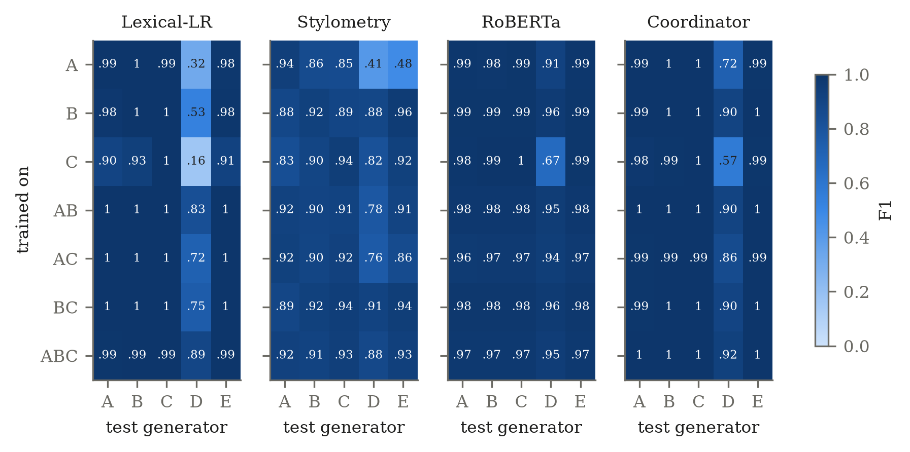
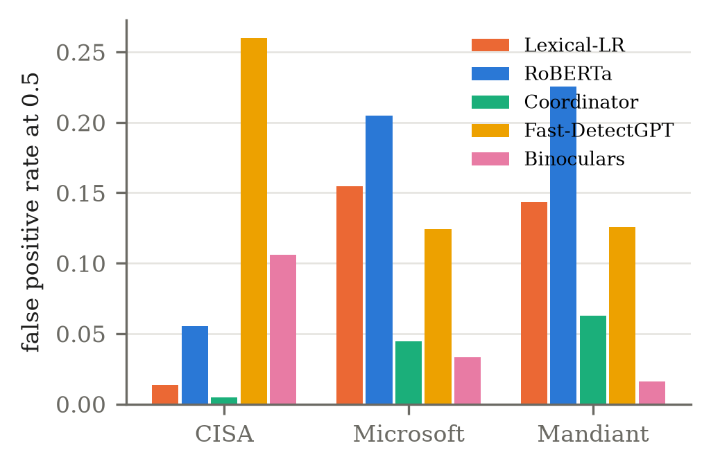
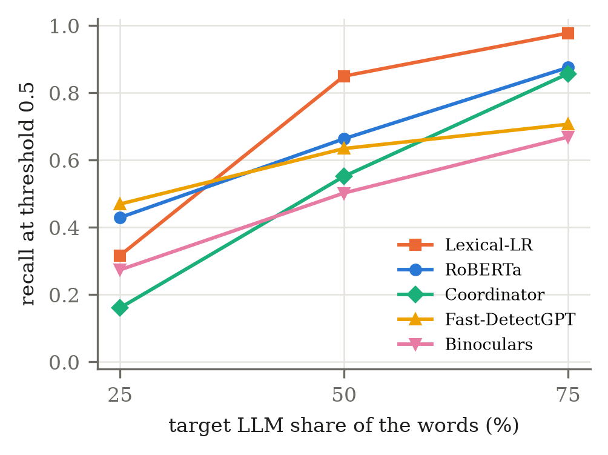

# Detecting LLM-Generated Cyber Threat Intelligence with Multiple Agents

- **Student:** Furkan Çolak, M.Sc. student, Department of Computer Engineering, Graduate School of Natural and
  Applied Sciences, Kırşehir Ahi Evran University (colak.furkan@ogr.ahievran.edu.tr, furkancolakofficial@gmail.com)
- **Course:** Information Security (graduate), instructor Asst. Prof. Gülsüm Akkuzu Kaya; midterm research project
- **Paper:** English [PDF](paper/en/main.pdf) / [LaTeX](paper/en/main.tex), Turkish [PDF](paper/tr/main.pdf) /
  [LaTeX](paper/tr/main.tex), IEEEtran journal format

## Research question

Can cyber threat intelligence (CTI) texts generated by large language models be told apart from human-written CTI
reports with NLP methods, and does a detector trained on one LLM still work on another?

**H1.** Human-written and LLM-generated CTI differ in statistical and linguistic properties that machine learning
models can use.

## Design in one paragraph

Human excerpts come from CISA advisories, alerts and analysis reports released on or before 2022-11-30, and, for
testing only, from Microsoft Security Blog and Mandiant threat intelligence posts of the same period. For each
excerpt an Analyst agent extracts the facts as JSON, and for each generator a Writer agent and an Editor agent
write a new CTI text from those facts only, so all generators describe the same events. Test excerpts are also
paraphrased, back-translated, "humanized", written with other prompts and mixed sentence by sentence with the human
text. Detection is split across agents as well: Lexical-LR, Lexical-SVM, Stylometry, RoBERTa and an LLM Judge,
combined by a Coordinator agent, with Fast-DetectGPT and Binoculars as training-free references. Splits are made by
source report and audited for leakage, every experiment runs with three seeds, and the tests cover generator, publisher and rewriting shift, calibration and decision thresholds, the Coordinator against RoBERTa
(the member that holds up best under shift), inference cost and an error analysis of false negatives and false
positives.

## Data

| Source | Role | Texts |
|---|---|---|
| CISA advisories, alerts, analysis reports (2015-2022, public domain) | Human (label 0) | 406 excerpts from 203 reports |
| A: Llama 3.1 8B (Ollama, local) | training generator | 406 multi-agent + 83 single-agent |
| B: Qwen 2.5 7B (Ollama, local) | training generator | 405 + 83 |
| C: Mistral 7B (Ollama, local) | training generator | 406 + 83 |
| D: gpt-oss-120b (Groq API, free tier) | test-only generator | 248 multi-agent texts; all 191 excerpts of the test splits are covered |
| E: Gemini 3.1 Flash-Lite (Google API, free tier) | test-only generator | 305 multi-agent texts; the same 191 excerpts are covered |
| Microsoft Security Blog, threat intelligence research (2012-2022) | human, test only | 231 excerpts from 80 posts, plus A/B/C versions |
| Mandiant threat intelligence blog (2010-2022) | human, test only | 207 excerpts from 80 posts, plus A/B/C versions |
| Rewriting, prompt and mixing variants of A/B/C | LLM, test only | 6293 texts for the 191 test excerpts |

The analyst model is Llama 3.1 8B with JSON output; the LLM judge is Gemma 2 9B. Ollama model digests used:
`llama3.1:8b 46e0c10c039e`, `qwen2.5:7b 845dbda0ea48`, `mistral:7b 6577803aa9a0`, `gemma2:9b ff02c3702f32`.

Everything needed to reproduce the results is committed: `data/sources.csv`, `data/raw/human_chunks.jsonl` (CISA
text is public domain), `data/generated/*.jsonl` (every agent message, model, template and temperature) and
`data/processed/`. To rebuild the human data from scratch, `collect` downloads the pages listed in the CISA sitemap.
Microsoft and Mandiant posts are copyrighted, so only their URLs and excerpt hashes are committed
(`data/external/sources.csv`); `collect_ext` downloads them again and checks the hashes. A few analysis-report pages were blocked by the local antivirus because they embed malware samples; they are listed
in `data/blocked_by_antivirus.txt` and excluded.

## Models

| Agent | Method |
|---|---|
| Lexical-LR (baseline 1) | word 1-2-gram + char 3-5-gram TF-IDF, logistic regression |
| Lexical-SVM (baseline 2) | same features, linear SVM with Platt calibration |
| Stylometry | 32 features (length, MTLD/TTR, punctuation, repetition, POS shares), XGBoost |
| RoBERTa | `roberta-base` fine-tuned 3 epochs, max length 256, fp16 |
| LLM Judge | Gemma 2 9B, zero-shot probability that a text is AI-written |
| Coordinator | logistic regression on the agents' logits, fitted on the validation split |
| Fast-DetectGPT (reference) | analytic curvature with GPT-Neo 2.7B, Platt-mapped on validation |
| Binoculars (reference) | Falcon-7B / Falcon-7B-Instruct in 4-bit, two passes over a top-64 observer distribution |

## Technologies

Python 3.12 throughout. PyTorch and Hugging Face Transformers (RoBERTa fine-tuning; GPT-Neo 2.7B and Falcon-7B for
the zero-shot detectors, with bitsandbytes 4-bit loading), scikit-learn, XGBoost, spaCy, SciPy, statsmodels, pandas
and matplotlib. The local generators, the analyst and the judge run in Ollama; the test-only generators are called
through the Groq and Google Gemini APIs with httpx. The agents are plain Python classes, no agent framework. The
paper is written in LaTeX (IEEEtran) and compiled with Tectonic. Exact versions are pinned in
[requirements.txt](requirements.txt). Hardware: one RTX 4060 (8 GB) laptop GPU, 15 GB RAM, Windows 11.

## Installation

```
python -m venv C:\Users\<you>\venvs\llmcti          # keep the venv outside OneDrive
C:\Users\<you>\venvs\llmcti\Scripts\Activate.ps1
pip install -r requirements.txt
python -m spacy download en_core_web_sm
copy .env.example .env                                # only needed for the generate stage
```

For generation, install [Ollama](https://ollama.com) and pull the four models above. Set `OLLAMA_NUM_PARALLEL=3`.
`GROQ_API_KEY` and `GEMINI_API_KEY` go into `.env`, which is git-ignored and read only by `src/settings.py`.

## Running

Each stage reads the previous stage's files and writes its own:

```
python -m src.cli collect     --config configs/generation.yaml   # CISA pages -> data/raw
python -m src.cli collect_ext --config configs/generation.yaml   # Microsoft and Mandiant posts -> data/external
python -m src.cli generate    --config configs/generation.yaml   # agents -> data/generated
python -m src.cli variants    --config configs/generation.yaml   # rewriting, prompt and mixing variants
python -m src.cli build       --config configs/experiments.yaml  # cleaning, splits -> data/processed
python -m src.cli analyze     --config configs/experiments.yaml  # stylometry, statistics, n-grams
python -m src.cli zeroshot    --config configs/experiments.yaml  # Fast-DetectGPT and Binoculars scores
python -m src.cli detect      --config configs/experiments.yaml  # all detector agents -> results/preds
python -m src.cli evaluate    --config configs/experiments.yaml  # metrics, intervals, pooled tests, McNemar, figures
python -m src.cli calibrate   --config configs/experiments.yaml  # calibrators and threshold rules
python -m src.cli compare     --config configs/experiments.yaml  # Coordinator against its members and variants
python -m src.cli robust      --config configs/experiments.yaml  # publishers, rewriting, mixing, augmented training
python -m src.cli errors      --config configs/experiments.yaml  # FN/FP categories with base rates, contrasts, regressions
python -m src.cli leakage     --config configs/experiments.yaml  # split audit, near-duplicates, control trainings
python -m src.cli cost        --config configs/experiments.yaml  # inference time and GPU memory
python -m src.cli report      --config configs/experiments.yaml  # paper/numbers.tex and paper/tables
python -m src.cli verify      --config configs/experiments.yaml  # paper and tables against results, SHA-256 manifest
pytest tests/
```

To reproduce all results from the committed corpus without any API key, run `collect_ext` once (the external
excerpts are not committed), then `bash experiments/run_all.sh --from build <python>` or
`.\experiments\run_all.ps1 -From build`. On an RTX 4060 (8 GB) `zeroshot` takes about 1.5 hours, the LLM judge in
`detect` about 4 hours the first time (its scores are cached) and the detector trainings about 1 hour. Long stages
should run in their own terminal window. The free-tier API generators are filled over several days with
`bash experiments/resume_generation.sh <python> 3600`.

The paper is compiled with [Tectonic](https://tectonic-typesetting.github.io):
`tectonic -X compile paper/en/main.tex`.

## Experiment parameters

All parameters live in [configs/generation.yaml](configs/generation.yaml) and
[configs/experiments.yaml](configs/experiments.yaml).

- Seeds 42, 123, 2024; source-level split 70/10/20 per seed; threshold 0.5.
- Generation: 4 Writer templates, temperatures 0.7 and 1.0, analyst temperature 0.2, 20% of sources also get a
  single-agent version.
- One training run per generator subset (A, B, C, AB, AC, BC, ABC) and seed; every model is tested on every
  generator. This gives E1 in-generator, E2 cross-generator, E3 leave-one-out and E4 external (D, E).
- The same runs score the external publishers and the rewritten texts. Two augmented trainings (three seeds each):
  ABC plus one external publisher, and ABC plus paraphrased and single-agent texts of the training sources.
- Ablations: feature groups, output cleaning off, agency names masked, multi-agent to single-agent, unseen Writer
  template, Coordinator without each agent, length-matched subset.
- Calibration: Platt, temperature and isotonic, fitted on validation data. Threshold rules: fixed 0.5, best
  validation F1, pseudo-unseen generator, and the 99th/95th percentile of validation human scores.
- Coordinator variants: mean of member logits, best member on validation, stack fitted on unseen local generators,
  stack with the zero-shot detectors.
- Statistics: Mann-Whitney U with Cliff's delta and Benjamini-Hochberg for features; source-level bootstrap
  (2,000 resamples) for intervals and paired comparisons. Runs are pooled before testing so that each Holm family
  stays small (one test per detector and target, per scenario, or per condition and detector); per-run tests are
  reported after Benjamini-Hochberg. Exact McNemar between detectors, Holm-corrected per detector pair.
- Purging and leakage checks: reports whose excerpts are near-duplicates (word 5-gram containment of 0.5 or more)
  are grouped, the test split of each seed is kept, and every training or validation report in a group with a test
  report is removed (`data/processed/purged.csv`; the plain splits are in `splits_unpurged.json`). Every saved
  prediction is then checked against the split of its seed, every test text is compared with all training and
  validation texts under both splits (strict cut 0.2), the purged run is compared with the plain run
  (`results/before_purge/`, same test sets), and Lexical-LR and Stylometry are retrained with a split by excerpt and
  with shuffled labels.
- Error analysis: categories with their base rate among all texts, misclassified against correctly classified texts
  (Cliff's delta), and logistic regressions with source-clustered errors, for missed D texts (single-generator
  models) and flagged Microsoft/Mandiant excerpts (ABC models).

## Results

Mean F1 over three seeds, models trained on one of A, B, C (full tables in [results/](results/) and the paper):

| Detector | In-generator | Cross (A-C) | D: gpt-oss-120b | E: Gemini |
|---|---|---|---|---|
| Lexical-LR | 0.997 | 0.966 | 0.336 | 0.960 |
| Lexical-SVM | 0.998 | 0.975 | 0.351 | 0.969 |
| Stylometry | 0.935 | 0.869 | 0.704 | 0.784 |
| RoBERTa | 0.991 | 0.989 | 0.845 | 0.988 |
| LLM Judge | 0.504 | 0.504 | 0.499 | 0.628 |
| Fast-DetectGPT | 0.748 | 0.729 | 0.566 | 0.457 |
| Binoculars | 0.815 | 0.804 | 0.390 | 0.330 |
| Coordinator | 0.996 | 0.993 | 0.732 | 0.993 |

- Leakage: CISA posts some advisories twice, under an advisory code and a descriptive address. On the plain source
  split 9-14% of test excerpts had a near-duplicate in training or validation, some word for word. All results
  above come from the purged splits, where no test excerpt has one (largest containment 0.46) and no scored test
  row comes from a training or validation source (196,850 rows audited). Against the plain run F1 of the trained
  detectors changes by at most 0.036 (13 up, 11 down of 30); a split by excerpt does not raise the scores, and
  shuffled labels give ROC-AUC 0.45-0.54.
- On D, ROC-AUC stays at 0.98 for the lexical models: the texts are ranked correctly but fall below the 0.5
  threshold. Training on all three local generators raises Lexical-LR on D to 0.888 and RoBERTa to 0.947; a threshold
  set at the 95th percentile of validation human scores raises Lexical-LR to 0.869 without any D text.
- Both remedies cost false alarms on another publisher. Lexical-LR flags 0.3-0.4% of Microsoft and Mandiant human
  excerpts when trained on one generator, 5-6% on two and 14-15% on three (RoBERTa: 9-11%, 14-17%, 21-23%; CISA
  stays at 1-6%). Adding one vendor publisher to training brings the other to 5% or less. The training-free detectors
  show fewer false positives on vendor text than on CISA text.
- On D the trained detectors fail in one direction: after single-generator training their false positive rate on
  CISA text stays at the in-generator value (0-1.5%) while the false negative rate rises to 0.79 (Lexical-LR), 0.23
  (RoBERTa) and 0.40 (Coordinator). ROC-AUC stays at 0.98-0.99, and of the threshold-free measures only the Brier
  score and ECE register the shift (RoBERTa ECE 0.015 in-generator, 0.120 on D). The human 5% threshold brings the
  false negative rate down to 0.06-0.20. Fast-DetectGPT and Binoculars lose the ranking itself (AUC 0.70-0.73 on D),
  which no threshold repairs.
- Consistency: `verify` recomputes all 2,166 rows of `results/metrics_all.csv` from the per-text predictions with
  separate code (largest difference 0), rebuilds the 2,418 macros and 38 tables of the papers from `results/` and
  finds them identical, and writes `results/manifest.csv` (SHA-256 of the result, data and figure files, LF line
  endings) to check any copy of the repository against.
- Error analysis: missed D texts are less diverse than caught ones and, for Lexical-LR and the Coordinator, longer
  and richer in proper nouns; D uses the first person in 10% of its texts (CISA 14%, Gemini 45%, local generators
  39-61%). Flagged vendor excerpts are more diverse, use the first person more and are shorter than the ones that
  pass. The two failures mirror each other.
- Paraphrasing, back-translation and a "humanize" prompt leave the trained detectors' recall at 0.99 or above, but
  lower Fast-DetectGPT and Binoculars. Single-agent rewriting from the source (recall 0.57-0.73) and texts with 25%
  LLM sentences (0.16-0.43) are missed.
- Calibration fitted on validation data improves in-generator probabilities and makes them worse on D (NLL of
  Lexical-LR 0.57 raw, 1.82 after Platt scaling).
- The Coordinator beats RoBERTa in 13 of 22 scenarios and loses in 4 (D after one training generator, single-agent
  texts, texts with 25% and 50% LLM sentences), because it weights Lexical-SVM heavily and that member collapses under
  generator shift.
- On texts with 50% LLM sentences RoBERTa finds 97% when the LLM block comes first and 34% when it comes last; it
  reads only the first 256 tokens.

The paper takes every number from `paper/numbers.tex`; the figures above are copied from it on 2026-11-12 (second
run, purged splits).

F1 per training set (rows) and test generator (columns), mean of three seeds:



False positive rate on human text of each publisher, models trained on CISA only, and recall on texts that mix
human and LLM sentences:

 

All figures are in [figures/](figures/) and in the paper.

## References

The paper cites 32 sources in IEEE style; the BibTeX entries are in [paper/refs.bib](paper/refs.bib), each checked
against its DOI, ACL Anthology, PMLR or arXiv page. The detectors used as references follow Bao et al. (2024,
Fast-DetectGPT) and Hans et al. (2024, Binoculars).

## Repository layout

```
configs/      generation and experiment parameters
data/         raw human excerpts, generated texts, processed dataset and splits
src/          one module per stage (collect, agents, variants, dataset, features, zeroshot, detectors, evaluate,
              calibration, compare, robust, errors, leakage, cost, report, verify)
experiments/  run_all.sh / run_all.ps1, resume_generation.sh
results/      metrics, statistics, predictions per text
figures/      figures used in the paper
notebooks/    read-only exploration of data and results
paper/        LaTeX sources (en, tr), generated numbers and tables, references
tests/        split leakage, cleaning, secret scan
```
